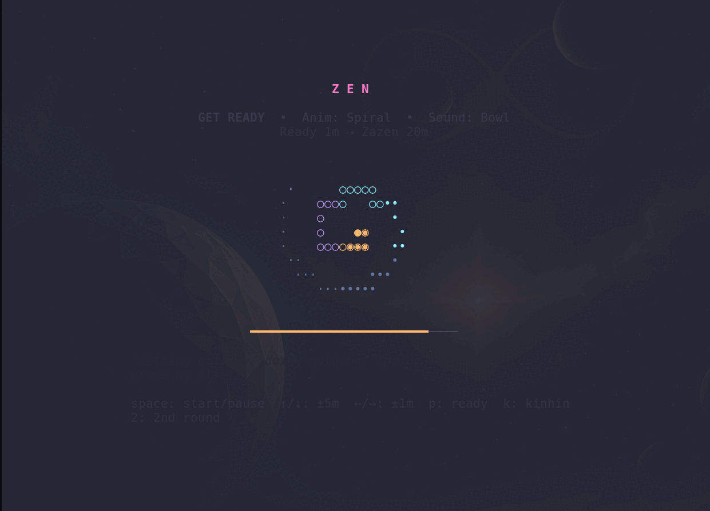

# 🌀 Zazen TUI

<p align="center">
  
</p>

A minimalist terminal user interface (TUI) for Zazen & Kinhin meditation, built with [Textual](https://textualize.io) and the **Dracula** theme.

## ✨ Key Features

- **Rotating Spiral & Focus Mode (`a`):** Smooth open spiral animation with a Dracula color gradient — auto-fades UI hints after 2.5 seconds for distraction-free sitting.
- **Complete Zen Session Flow (`p` / `k` / `2`):** Configure preparation countdown (`0–5 min`), Zazen (`1–120 min`), Kinhin walking meditation (`5–15 min`), and an optional 2nd Zazen round.
- **Synthesized Singing Bowl Audio (`s`):** Generates harmonic singing bowl and bell tones in-memory via `paplay` / `aplay` with a subtle Visual Bell.
- **Multi-Language & Koans (`Ctrl+P` / `l` / `c`):** Switch between German, English, and Japanese via the Command Palette and cycle through traditional Zen Koans.

## 📦 Installation

```bash
pipx install git+https://github.com/postsonde/zazen-tui.git
```

## 🚀 Usage

```bash
zazen
```

### Shortcuts

| Key | Action |
| :--- | :--- |
| `Space` | Start / Pause session |
| `↑` / `↓` | Adjust Zazen (`±5 min`) |
| `←` / `→` | Fine-tune Zazen (`±1 min`) |
| `p` | Set preparation timer (`0–5 min`) |
| `k` | Cycle Kinhin duration (`Off / 5m / 10m / 15m`) |
| `2` | Toggle 2nd Zazen round |
| `a` | Toggle spiral animation |
| `t` | Cycle timer display (`Bar / Digits / Hidden`) |
| `s` | Cycle sound (`Bowl / Bell / System / Mute`) |
| `c` | Next Zen Koan |
| `l` | Cycle language (`DE / EN / JP`) |
| `Ctrl+P` | Command Palette |
| `r` | Reset timer |
| `q` | Quit |

## 📄 License

GNU General Public License v3.0 (GNU GPLv3) 🄯 [postsonde](https://github.com)
