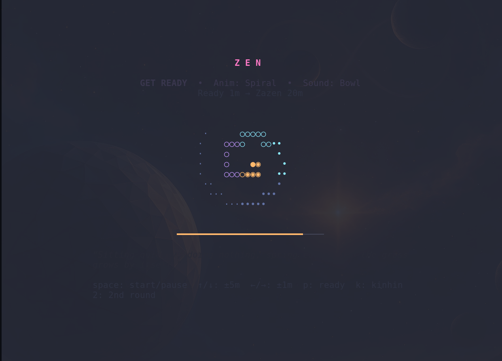
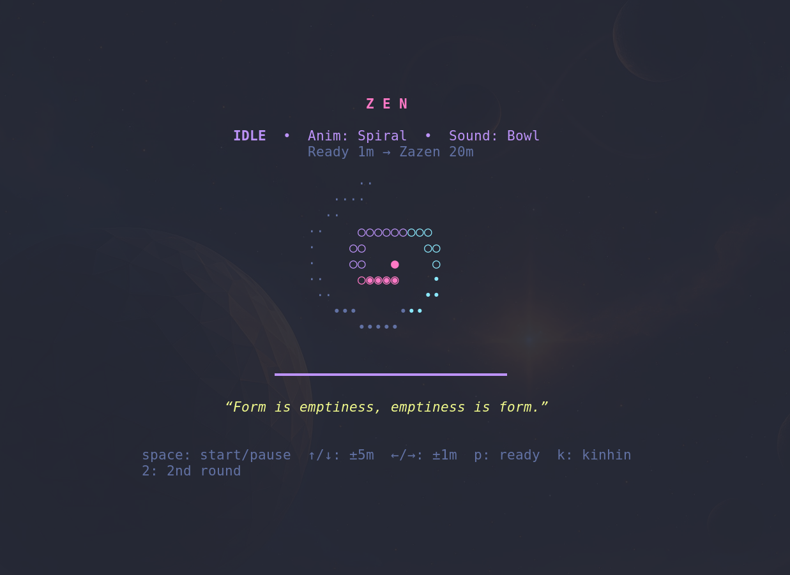

# 🌀 zazen-tui


> **A compact, distraction-free Zazen & Kinhin meditation TUI built with Python and Textual — styled in Dracula dark mode.**

---

## 📸 Screenshots

| Active Session & Rotating Spiral | Command Palette (`Ctrl+P`) & Multi-Language |
| :---: | :---: |
|  |  |

---

## ✨ Features

- **Rotating Open Spiral:** Smooth ASCII/Unicode spiral with a Dracula color gradient (`#ff79c6` → `#bd93f9` → `#8be9fd` → `#6272a4`), toggleable for pure minimal mode.
- **Full Zen Session Flow:** Configurable **Get Ready** countdown (`0–5 min`), **Zazen** (`1–120 min`), optional **Kinhin** walking meditation (`5 / 10 / 15 min`), and an optional **2nd Zazen round**.
- **Zero-Dependency Singing Bowl Audio:** Synthesizes warm harmonic singing bowl and bell tones in-memory (`paplay` / `aplay`), paired with a smooth **Visual Bell**.
- **Auto-Fade Focus Mode:** Controls and Koans automatically fade out 2.5 seconds after starting so nothing breaks your focus.
- **Multi-Language & Koans (`Ctrl+P`):** Switch seamlessly between **Deutsch (`DE`)**, **English (`EN`)**, and **日本語 (`JP`)** via the Textual Command Palette (`Ctrl+P`) or `l`.
- **Flexible Timer Display:** Cycle between a minimal progress bar, classic digits, or completely hidden time.

---

## 🚀 Installation (Debian / Linux)

### Option 1: Isolated CLI install via `pipx` (Recommended)
```bash
pipx install git+https://github.com/postsonde/zazen-tui.git
```
Run from anywhere in your terminal:
```bash
zazen
```


*(Note: For synthesized singing bowl audio on Debian, ensure `pulseaudio-utils` (`paplay`) or `alsa-utils` (`aplay`) is available — both are pre-installed on most desktop setups.)*

---

## ⌨️ Keybindings

| Key | Action |
| :--- | :--- |
| `Space` | Start / Pause session |
| `↑` / `↓` | Adjust Zazen duration (`±5 min`) |
| `←` / `→` | Fine-tune Zazen duration (`±1 min`) |
| `p` | Set preparation / ready timer (`0–5 min`) |
| `k` | Cycle Kinhin duration (`Off / 5m / 10m / 15m`) |
| `2` | Toggle 2nd Zazen round after Kinhin |
| `a` | Toggle spiral animation (`Spiral / Pure`) |
| `t` | Cycle timer display (`Bar / Digits / Hidden`) |
| `s` | Cycle sound (`Singing Bowl / Bell / System / Mute`) |
| `c` | Show next random Zen Koan |
| `l` | Cycle language (`DE / EN / JP`) |
| `Ctrl+P` | Open Textual Command Palette (Languages, Koans, Screenshot) |
| `r` | Reset timer |
| `q` | Quit |

---

## 🧛 Theme

Crafted with the official **[Dracula Color Palette](https://draculatheme.com)**:
- Background: `#282a36`
- Visual Bell / Subtle UI: `#44475a` / `#6272a4`
- Accents: `#ff79c6` (Pink), `#bd93f9` (Purple), `#8be9fd` (Cyan), `#ffb86c` (Orange), `#f1fa8c` (Yellow)

---

## 📄 License

GNU GPLv3.0 [postsonde](https://github.com/postsonde)
